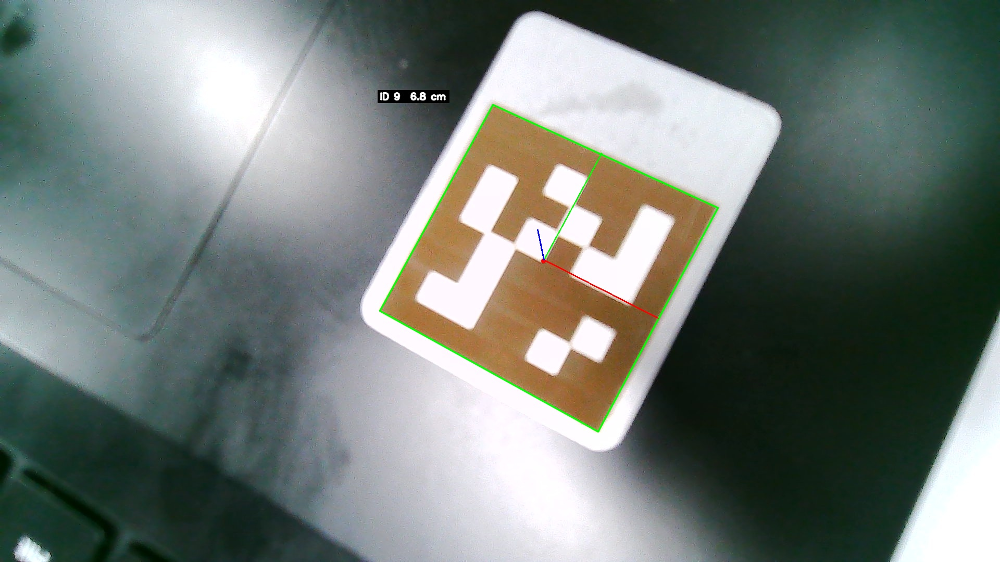

# RoboGame 2025 Vision

[English](README.md) | [简体中文](README.zh-CN.md)

[](https://www.python.org/)
[](https://opencv.org/)
[](LICENSE)


AprilTag detection and 6-DoF pose estimation for the USTC RoboGame 2025 robot.
The pipeline was built for an **Orange Pi 5 Plus** and uses a calibrated camera
to turn a `tag36h11` marker into a metric pose (translation + orientation) for
the robot controller.

> **Project status:** archived. This repository is kept for reference and is no
> longer maintained.



## Features

- `tag36h11` AprilTag detection with corner refinement.
- 6-DoF pose from `cv2.solvePnP`, using the camera intrinsics and distortion
  coefficients produced by the bundled calibration.
- Chessboard camera calibration script and reproducible sample data.
- Single command-line entry point for a camera, a video file, or a still image.
- Headless mode and JSON output for scripting.
- No hard dependency on a GUI: the detector itself only needs OpenCV and an
  AprilTag backend.

## Hardware and software

| Item | Value |
| --- | --- |
| Robot platform | Orange Pi 5 Plus |
| Camera | 1920 x 1080 USB camera |
| Python | 3.10+ (tested with 3.12 on Windows 11) |
| OpenCV | 4.10 |
| NumPy | 1.26 |
| AprilTag backend | `pupil-apriltags` or `apriltag` |

The original robot deployment used the `apriltag` Python binding on the Orange
Pi. The code also works with `pupil-apriltags`, which has prebuilt wheels for
Windows, macOS, and x86-64 Linux. Only one backend is needed; the import is
resolved at runtime.

## Repository layout

```text
.
├── main.py                     # CLI: camera, video, or single image
├── config.py                   # default camera and detector settings
├── modules/
│   ├── apriltag_detector.py    # detection, PnP pose, drawing
│   └── camera_calibration.py   # chessboard calibration helpers
├── scripts/
│   └── calibrate.py            # calibration CLI
├── data/
│   ├── camera_calibration.npz  # sample calibration used by the demo
│   └── calibration_images/
│       └── 1920_1080/          # 22 chessboard photos
├── assets/
│   ├── test_image.jpg          # sample AprilTag image
│   └── test_result.jpg         # annotated output
├── experimental/
│   └── led_detector.py         # abandoned LED experiment (not imported)
├── requirements.txt
└── LICENSE
```

## Installation

```bash
git clone https://github.com/EatingNoLine/robogame-2025-vision.git
cd robogame-2025-vision
python -m venv .venv
```

Activate the environment:

```bash
# Linux / macOS
source .venv/bin/activate
# Windows PowerShell
.venv\Scripts\Activate.ps1
```

Install the dependencies:

```bash
pip install -r requirements.txt
```

On an ARM Linux board where `pupil-apriltags` has no wheel, install the
alternative backend instead:

```bash
pip install numpy opencv-python apriltag
```

## Camera calibration

The bundled calibration was produced from the 22 images in
`data/calibration_images/1920_1080` using a chessboard with **7 x 7 inner
corners** and **10 mm squares**. 21 of the 22 images were usable; OpenCV
reported an RMS reprojection error of **0.487 px**.

To calibrate your own camera:

```bash
python scripts/calibrate.py \
    --images data/calibration_images/1920_1080 \
    --cols 7 --rows 7 --square-size 0.01 \
    --output data/camera_calibration.npz
```

Tips:

- Print the board on a rigid, flat surface and measure the square size; use the
  measured value for `--square-size`.
- Capture 15-25 views with different angles, positions, and distances.
- Avoid glare and motion blur; the board must be fully visible in each frame.
- Calibrate at the **same resolution** you use at runtime. The sample
  calibration is for 1920 x 1080; using it with 640 x 480 frames will produce
  wrong poses.

The resulting `camera_calibration.npz` contains `camera_matrix`,
`dist_coeffs`, and the per-view `rvecs` / `tvecs`.

## Usage

Run from the repository root so the default paths resolve.

```bash
# Default camera (device 0)
python main.py --source 0

# Orange Pi camera or another device index
python main.py --source 20 --width 1920 --height 1080

# A single image: detect, print the pose, and save the overlay
python main.py --source assets/test_image.jpg --output assets/test_result.jpg

# Headless / machine-readable output
python main.py --source assets/test_image.jpg --no-display --json
```

Controls in camera/video mode:

- `q` or `Esc` — quit
- `s` — save the current annotated frame

Useful options:

| Option | Meaning |
| --- | --- |
| `--calib PATH` | calibration file (default `data/camera_calibration.npz`) |
| `--tag-size METRES` | edge length of the black tag square |
| `--tag-family NAME` | AprilTag family (default `tag36h11`) |
| `--width`, `--height` | requested capture resolution |
| `--max-frames N` | stop after N frames |
| `--no-display` | do not open a GUI window |
| `--json` | print detections as JSON (single-image mode) |

Example JSON output:

```json
[
  {
    "id": 9,
    "center": [1043, 501],
    "corners": [[729, 597], [1148, 829], [1378, 399], [946, 201]],
    "distance_m": 0.0678,
    "translation_m": [0.0052, -0.0047, 0.0674],
    "euler_deg": [177.0, 9.2, 27.9]
  }
]
```

## How it works

1. Convert the frame to grayscale and detect `tag36h11` markers with the AprilTag
   backend.
2. Refine the four tag corners and match them to the known 3-D coordinates of a
   square of side `tag_size`.
3. Solve the Perspective-n-Point problem with `cv2.solvePnP`, using the
   calibrated camera matrix and distortion coefficients.
4. Draw the tag outline, its ID, the measured distance, and a camera-frame
   coordinate triad on the image.

The pose is expressed in the camera coordinate system: `tvec` is in metres and
`rvec` is a Rodrigues rotation vector. `analyze_pose()` converts the rotation to
Z-Y-X Euler angles (`roll, pitch, yaw`) in degrees.

## Results

The included demo (`assets/test_image.jpg`, 3 cm tag) produces:

```text
Tag 9: center=(1043, 501), distance=0.068 m, rpy=(177.0, 9.2, 27.9) deg
```

Calibration summary:

```text
image size:                 1920 x 1080
usable views:               21 / 22
RMS reprojection error:     0.487 px
mean per-view RMS error:    0.436 px

camera matrix:
[[1072.213,    0.000,  960.804],
 [   0.000, 1075.105,  574.743],
 [   0.000,    0.000,    1.000]]

distortion:
[-0.05869, 0.06740, 0.00169, 0.00338, 0.08521]
```

All bundled photographs have had their EXIF/GPS metadata removed; the pixel data
was not re-encoded.

## Limitations

- Only one tag is used per frame; there is no multi-tag fusion or temporal
  filtering.
- Pose accuracy depends on the measured `tag_size` and on calibrating at the
  runtime resolution.
- The camera is assumed to be globally shuttered and reasonably free of motion
  blur.
- `experimental/led_detector.py` is an abandoned experiment and is not part of
  the pipeline.
- The repository is archived; issues and pull requests are not monitored.

## Acknowledgements

- USTC RoboGame 2025 organizers and teammates.
- [AprilTag](https://github.com/AprilRobotics/apriltag) by the April Robotics
  Laboratory, University of Michigan.
- [pupil-apriltags](https://github.com/pupil-labs/apriltags) by Pupil Labs.
- [OpenCV](https://opencv.org/) and [NumPy](https://numpy.org/).

## License

[MIT](LICENSE) (c) 2025 lyingloong
