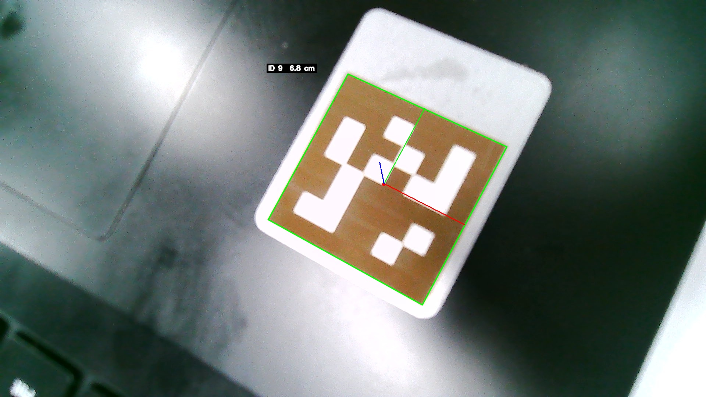

# RoboGame 2025 视觉模块

[English](README.md) | [简体中文](README.zh-CN.md)

[](https://www.python.org/)
[](https://opencv.org/)
[](LICENSE)


中国科学技术大学 RoboGame 2025 比赛机器人的视觉模块：检测 `tag36h11`
AprilTag，并结合相机标定参数估计标签相对相机的六自由度位姿。代码面向
**Orange Pi 5 Plus** 部署，输出可直接交给机器人控制层使用。

> **项目状态：已归档。** 本仓库仅作存档参考，不再维护。



## 功能

- `tag36h11` AprilTag 检测与角点优化。
- 基于 `cv2.solvePnP` 的六自由度位姿解算，使用标定得到的内参与畸变系数。
- 棋盘格相机标定脚本，以及可复现的样例标定数据。
- 一个命令行入口，支持摄像头、视频文件和单张图片。
- 支持无显示器（headless）运行和 JSON 输出。
- 检测核心只依赖 OpenCV 和一个 AprilTag Python 后端，不强制依赖 GUI。

## 硬件与软件

| 项目 | 说明 |
| --- | --- |
| 机器人平台 | Orange Pi 5 Plus |
| 相机 | 1920 x 1080 USB 相机 |
| Python | 3.10+（在 Windows 11 + Python 3.12 上验证） |
| OpenCV | 4.10 |
| NumPy | 1.26 |
| AprilTag 后端 | `pupil-apriltags` 或 `apriltag` |

最初在 Orange Pi 上部署时使用 `apriltag` Python 绑定；代码同时兼容
`pupil-apriltags`（Windows、macOS、x86-64 Linux 有预编译 wheel）。两者只需
安装一个，运行时自动识别。

## 目录结构

```text
.
├── main.py                     # 命令行入口：摄像头 / 视频 / 图片
├── config.py                   # 相机与检测器默认参数
├── modules/
│   ├── apriltag_detector.py    # 检测、PnP 位姿、绘制
│   └── camera_calibration.py   # 棋盘格标定
├── scripts/
│   └── calibrate.py            # 标定命令行脚本
├── data/
│   ├── camera_calibration.npz  # 示例标定结果
│   └── calibration_images/
│       └── 1920_1080/          # 22 张棋盘格照片
├── assets/
│   ├── test_image.jpg          # AprilTag 测试图
│   └── test_result.jpg         # 检测结果
├── experimental/
│   └── led_detector.py         # 已放弃的 LED 检测实验（主流程不引用）
├── requirements.txt
└── LICENSE
```

## 安装

```bash
git clone https://github.com/EatingNoLine/robogame-2025-vision.git
cd robogame-2025-vision
python -m venv .venv
```

激活虚拟环境：

```bash
# Linux / macOS
source .venv/bin/activate
# Windows PowerShell
.venv\Scripts\Activate.ps1
```

安装依赖：

```bash
pip install -r requirements.txt
```

在 ARM Linux 上如果 `pupil-apriltags` 没有可用 wheel，可改用：

```bash
pip install numpy opencv-python apriltag
```

## 相机标定

仓库自带的标定结果由 `data/calibration_images/1920_1080` 中的 22 张照片
生成，使用 **7 x 7 内角点**、**10 mm 方格** 的棋盘格。其中 21 张可用，
OpenCV 报告的 RMS 重投影误差为 **0.487 px**。

重新标定自己的相机：

```bash
python scripts/calibrate.py \
    --images data/calibration_images/1920_1080 \
    --cols 7 --rows 7 --square-size 0.01 \
    --output data/camera_calibration.npz
```

注意事项：

- 棋盘格要打印在平整、刚性好的表面上，并用尺子量出实际方格边长，填入
  `--square-size`（单位：米）。
- 拍摄 15-25 个不同角度、位置和距离的视图。
- 避免反光和运动模糊，保证棋盘格完整出现在画面中。
- 标定分辨率必须与运行时分辨率一致。仓库中的标定对应 1920 x 1080；
  如果实际采集 640 x 480，位姿会明显不准。

输出的 `camera_calibration.npz` 包含 `camera_matrix`、`dist_coeffs` 以及
每个视图的 `rvecs` / `tvecs`。

## 使用

请在仓库根目录运行，默认相对路径才能正确解析。

```bash
# 默认摄像头（设备 0）
python main.py --source 0

# Orange Pi 上的相机或其他设备号
python main.py --source 20 --width 1920 --height 1080

# 单张图片：检测、打印位姿并保存结果图
python main.py --source assets/test_image.jpg --output assets/test_result.jpg

# 无显示器 / 机器可读输出
python main.py --source assets/test_image.jpg --no-display --json
```

摄像头/视频模式下的按键：

- `q` 或 `Esc`：退出
- `s`：保存当前带标注的画面

常用参数：

| 参数 | 含义 |
| --- | --- |
| `--calib PATH` | 标定文件（默认 `data/camera_calibration.npz`） |
| `--tag-size METRES` | 标签黑色方块的边长，单位米 |
| `--tag-family NAME` | AprilTag 家族（默认 `tag36h11`） |
| `--width`, `--height` | 请求的采集分辨率 |
| `--max-frames N` | 处理 N 帧后停止 |
| `--no-display` | 不打开 GUI 窗口 |
| `--json` | 以 JSON 输出检测结果（单图模式） |

JSON 输出示例：

```json
[
  {
    "id": 9,
    "center": [1043, 501],
    "corners": [[729, 597], [1148, 829], [1378, 399], [946, 201]],
    "distance_m": 0.0678,
    "translation_m": [0.0052, -0.0047, 0.0674],
    "euler_deg": [177.0, 9.2, 27.9]
  }
]
```

## 实现原理

1. 将画面转为灰度图，调用 AprilTag 后端检测 `tag36h11` 标签。
2. 提取四个角点，与边长为 `tag_size` 的正方形三维角点一一对应。
3. 使用标定得到的内参和畸变系数，通过 `cv2.solvePnP` 求解 PnP 位姿。
4. 在图像上绘制标签轮廓、ID、距离，以及相机坐标系下的坐标轴。

位姿定义在相机坐标系中：`tvec` 的单位为米，`rvec` 为 Rodrigues 旋转向量。
`analyze_pose()` 会把旋转转换为 Z-Y-X 顺序的欧拉角（`roll, pitch, yaw`），
单位为度。

## 结果

仓库中的示例图（标签边长 3 cm）输出：

```text
Tag 9: center=(1043, 501), distance=0.068 m, rpy=(177.0, 9.2, 27.9) deg
```

标定结果摘要：

```text
图像尺寸:                 1920 x 1080
可用视图:                 21 / 22
RMS 重投影误差:           0.487 px
单视图平均 RMS 误差:      0.436 px

相机内参:
[[1072.213,    0.000,  960.804],
 [   0.000, 1075.105,  574.743],
 [   0.000,    0.000,    1.000]]

畸变系数:
[-0.05869, 0.06740, 0.00169, 0.00338, 0.08521]
```

仓库内所有照片均已移除 EXIF/GPS 元数据，像素数据未重新编码。

## 限制

- 每帧只使用一个标签，没有多标签融合或时序滤波。
- 位姿精度取决于 `tag_size` 的测量值和运行时分辨率下的标定质量。
- 假设相机为全局快门，且画面没有明显运动模糊。
- `experimental/led_detector.py` 是已放弃的实验代码，不属于主流程。
- 仓库已归档，不再处理 issue 和 pull request。

## 致谢

- 中国科学技术大学 RoboGame 2025 的主办方和队友。
- 密歇根大学 April Robotics Laboratory 的
  [AprilTag](https://github.com/AprilRobotics/apriltag)。
- Pupil Labs 的
  [pupil-apriltags](https://github.com/pupil-labs/apriltags)。
- [OpenCV](https://opencv.org/) 与 [NumPy](https://numpy.org/)。

## 许可证

[MIT](LICENSE) (c) 2025 lyingloong
